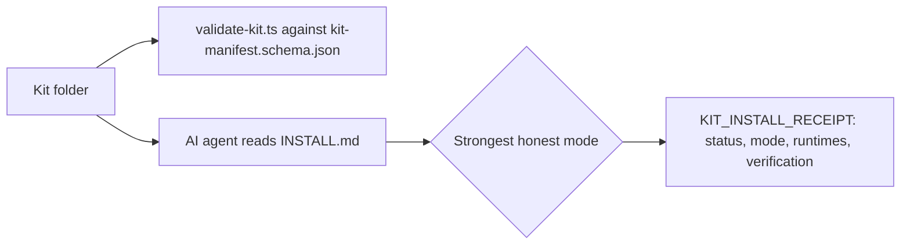

# Portable Kits

The packaging contract, validator and reference kit for self-contained AI kits
that a person can unzip, hand to an AI agent, and install by saying "Read
`INSTALL.md` and install this kit."

> Portfolio piece. Source shown for review only; not licensed for use. See LICENSE.

## What it does

This folder defines what an installable AI kit is and enforces it:

- `kit-manifest.schema.json`: the JSON Schema for `kit.json` (identity,
  requirements, payloads, boundaries, verification).
- `validate-kit.ts`: checks a kit's manifest contract and every declared
  package path.
- `generate-install-integrity.ts`: regenerates a kit's copied-install integrity
  record after an intentional payload edit.
- `synthetic-customer-panel/`: the reference kit, a synthetic focus-group panel
  that tests a marketing artifact against 5-15 researched customer composites.

## The problem

Handing an AI agent a folder of prompts and scripts and saying "install this"
usually produces an install nobody can check: the agent improvises file
operations, silently skips what its environment cannot do, and reports success
either way. This contract makes the kit declare its desired finished state and
the agent report, honestly, which mode it actually achieved.

## How it works

Every kit carries `INSTALL.md` (agent-facing instructions), `kit.json` and its
schema, `README.md`, `VERSION` and `CHANGELOG.md`. The agent owns environment
detection and tool choice; the kit owns the finished state, declared runtimes,
safety boundaries and proof of success. The installing agent picks the
strongest mode it can honestly support (full, persistent files, session only,
or handoff required) and ends with a fixed-format receipt. The validator and
the contract test suite keep the reference kit conforming.



## Features

- **Declared, inspectable installs.** Every payload, destination, external
  write, preserved path and forbidden location is declared in `kit.json`; no
  hidden download-and-execute steps; unrelated collisions are never
  overwritten.
- **Honest install modes.** An agent may never report a full install after
  completing a weaker one.
- **Runtime policy.** TypeScript runs directly on Node 22.6+; Python, where a
  kit uses it, runs through `uv`. Only declared runtimes are checked, and
  machine-level installs need the operator's permission.
- **Reference panel kit.** Evidence-labeled dossiers per seat, independent seat
  runs, synthesis that keeps dissent, owner-weighted scoring, three tested
  rewrites, and calibration against later real outcomes.

The panel workflow follows the synthetic focus-group method demonstrated in
Corey Ganim's interview with Justin Brooke.

## Stack

TypeScript run directly by Node (no build step), JSON Schema, Markdown skill
and workflow files, bash for the panel's room lifecycle, `node --test`.

## Status

Experimental. The contract, validator and reference kit are a working proof of
concept with a contract regression suite; the reference kit has been dogfooded
internally but not against a paying customer.

## Running it locally (for reviewers)

```text
npm run check
```

Runs the contract regression suite and validates the reference kit.

## Screenshots

None.

## Author

Rico Rojas, rico@rtech-consulting.com, https://rico-rojas.com
