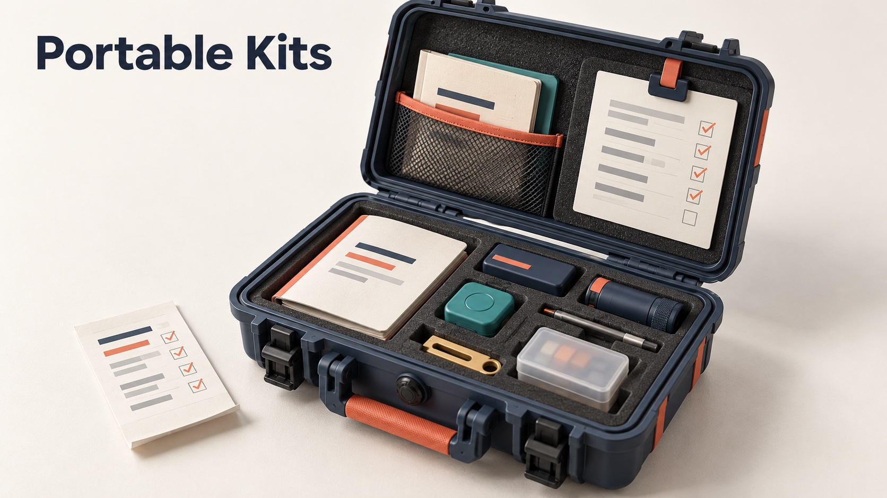
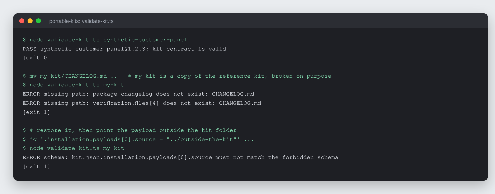
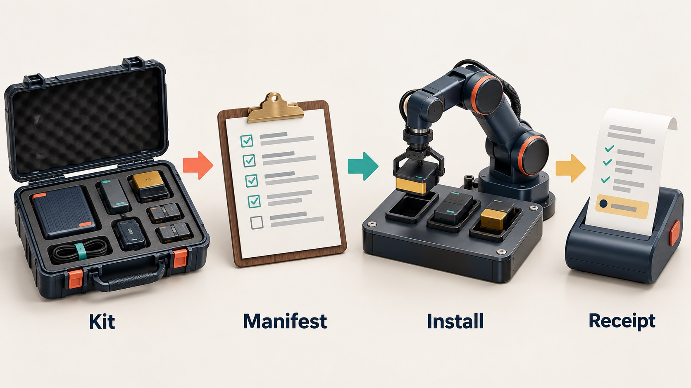

# Portable Kits

A packaging contract, validator and reference kit for AI kits that a person
can unzip, hand to an AI agent, and install with one sentence: "Read
`INSTALL.md` and install this kit."


-3178c6)



## What it is

The rules and tools that define what an installable AI kit is, plus one kit
built to those rules:

- `kit-manifest.schema.json`: the JSON Schema for a kit's `kit.json`
  (identity, runtimes, payloads, boundaries, verification).
- `validate-kit.ts`: checks a kit's manifest against the schema and checks
  that every declared path exists and stays inside the kit folder.
- `generate-install-integrity.ts`: regenerates a kit's installed-payload
  integrity record after an intentional edit.
- `synthetic-customer-panel/`: the reference kit, a synthetic focus-group
  panel that tests a piece of marketing against 5-15 researched customer
  composites before it goes out.



*Real runs of `validate-kit.ts`: the reference kit passes, a copy with its
changelog removed fails, and a copy whose payload points outside the kit
folder fails the schema. `[exit N]` lines are the shell's exit status.*

## Why it exists

Hand an AI agent a folder of prompts and scripts and say "install this", and
the result is usually an install nobody can check. The agent improvises file
operations, quietly skips whatever its environment cannot do, and reports
success either way. This contract makes the kit declare the finished state it
wants and makes the agent report, in a fixed format, which install mode it
actually reached.

## How it works



Every kit carries `INSTALL.md` (instructions written for the agent),
`kit.json` and its schema, `README.md`, `VERSION` and `CHANGELOG.md`. The kit
owns the finished state, the declared runtimes, the safety boundaries and the
proof of success. The agent owns environment detection and tool choice. It
picks the strongest mode it can honestly support (full, persistent files,
session only, or handoff required) and ends with a `KIT_INSTALL_RECEIPT`
stating status, mode, runtimes and verification. `validate-kit.ts` and the
contract test suite keep kits conforming before they ship.

## Features

- **Declared, inspectable installs.** Every payload, destination, external
  write, preserved path and forbidden location is declared in `kit.json`.
  No hidden download-and-run steps, and unrelated files at the destination are
  never overwritten.
- **Honest install modes.** An agent may not report a full install after
  completing a weaker one.
- **Path confinement.** Declared paths are resolved through symlinks and must
  stay inside the kit; every verification command must point at a declared
  local entrypoint.
- **Copied-install integrity.** A kit can prove that an installed copy matches
  its retained source, file by file.
- **Plain runtimes.** TypeScript runs directly on Node with no build step and
  no `npm install` for the buyer; Python, where a kit uses it, runs through
  `uv`.
- **Reference panel kit.** Evidence-labelled dossiers per seat, independent
  seat runs, synthesis that keeps dissent, owner-weighted scoring, tested
  rewrites, calibration against later real outcomes, and a room lifecycle
  (`room.sh`) that resets a panel without deleting its history.

## Run it locally (for review)

Requires Node 22.18 or newer.

```bash
npm run check                                   # contract tests, then validate the reference kit
node validate-kit.ts synthetic-customer-panel   # validator only
cd synthetic-customer-panel && npm test         # the reference kit's own test
```

Licence: free for personal and non-commercial use with credit; commercial use
needs a licence. See `LICENSE` (PolyForm Noncommercial 1.0.0) or write to
rico@rtech-consulting.com.

## How it was built

The contract started in July 2026 as the base for a line of AI kits and was
tightened in August as the kits were reviewed, made portable across AI apps,
and moved off Bun onto plain Node. Dates, decisions and the mistakes that
shaped it are in [docs/BUILD-STORY.md](docs/BUILD-STORY.md).

## Project status

Experimental. The contract, validator and reference kit work and have a
regression suite. Known gap at this snapshot: 15 of 16 contract tests pass.
The copied-install test fails because folder README files added on 2026-08-24
are not yet in the reference kit's integrity record
(`KIT-METADATA.json`); regenerating it with `npm run generate:integrity` is
the pending fix. The reference kit has been used internally, not yet with a
paying customer.

## Credits

The panel workflow follows the synthetic focus-group method shown in Corey
Ganim's interview with Justin Brooke.

## Author

Rico Rojas, https://rico-rojas.com
